# FormCraft

FormCraft is a dynamic form builder and form-submission application. Admins define forms and publish them; public visitors can fill out published forms; admins can review, paginate, and delete responses.

This README describes the implementation in this repository. Scalability ideas are labeled as proposals and are not claims about deployed or benchmarked capacity.

## Table of contents

- [Project Overview](#project-overview)
- [Key Features](#key-features)
- [Screenshots](#screenshots)
- [Technology Stack](#technology-stack)
- [Supported Dynamic Field Types](#supported-dynamic-field-types)
- [System Architecture](#system-architecture)
- [Database Design](#database-design)
- [Redux Toolkit Architecture](#redux-toolkit-architecture)
- [API Documentation](#api-documentation)
- [Validation and Security](#validation-and-security)
- [Installation and Setup](#installation-and-setup)
- [Postman Collection and API Testing](#postman-collection-and-api-testing)
- [Scalability and System Design](#scalability-and-system-design)
- [Current Limitations](#current-limitations)
- [Future Improvements](#future-improvements)

## Project Overview

The project is a React single-page application and an Express JSON API backed by MongoDB through Mongoose. It supports one initial admin account, form design and publishing, public form rendering, validated submissions, and admin submission management.

### Project directory

```text
FormCraft/
├── README.md
├── package.json                    # Starts backend and frontend in development
├── backend/
│   ├── .env.example
│   ├── config/db.js                 # Dotenv loading and Mongoose connection
│   ├── controllers/                 # Auth, forms, and submissions
│   ├── middleware/requireAdmin.js   # JWT cookie verification
│   ├── models/                      # Admin, Form, Submission
│   ├── routes/                      # Auth and form API routes
│   ├── scripts/                     # Local diagnostics/maintenance utilities
│   ├── test/                        # Node built-in mocked API-controller tests
│   └── utils/                       # Form and answer validation
├── frontend/
│   ├── src/
│   │   ├── components/              # Builder, preview, navigation, shared UI
│   │   ├── pages/                   # Dashboard, forms, builder, public form, submissions, login
│   │   ├── redux/                   # Redux Toolkit store and slices
│   │   ├── services/formsApi.js     # Fetch API client
│   │   └── style.css                # Responsive and theme styles
│   └── vite.config.js               # Development /api proxy
└── postman/
    └── FormCraft.postman_collection.json
```

## Key Features

- Admin dashboard and All Forms page backed by MongoDB forms, with status and creation date.
- Dynamic builder for form name, description, field properties, options, ordering, and live preview.
- Save Draft and Publish actions using the existing form API.
- Public route `/forms/:formId`, which loads a published form definition from the API.
- Frontend and backend validation before a public submission is accepted.
- Admin submission list with page controls, response detail view, and confirmed deletion.
- Light and dark themes with a browser-local theme preference.
- HTTP-only-cookie admin sessions and admin route authorization.

### Screenshots

No screenshots are currently included in the repository. Replace these placeholders with captured application screens when available.

- Dashboard: _Screenshot placeholder_
- Form Builder: _Screenshot placeholder_
- Public Form: _Screenshot placeholder_
- Submission Management: _Screenshot placeholder_

## Technology Stack

| Layer | Implemented technology |
| --- | --- |
| Frontend | React 19, Vite 7, CSS |
| Client state | Redux Toolkit and React Redux |
| Backend | Node.js, Express 5 |
| Data access | Mongoose 8 |
| Database | MongoDB (the configured URI may point to MongoDB Atlas or another compatible deployment) |
| Authentication | `bcryptjs`, `jsonwebtoken`, HTTP-only cookie |
| Request limits | `express-rate-limit` |
| API request collection | Postman Collection v2.1 |
| Backend tests | Node.js built-in test runner with mocked models |

The installed Vite version requires Node.js `^20.19.0 || >=22.12.0`. Use a compatible Node.js and npm installation.

## Supported Dynamic Field Types

The builder, public renderer, and backend validation support:

`TEXT`, `EMAIL`, `NUMBER`, `PHONE`, `TEXTAREA`, `DATE`, `SELECT`, `RADIO`, and `CHECKBOX`.

Form fields can store a label, unique key, type, placeholder, default value, required flag, options, minimum/maximum length, and minimum/maximum numeric values. `SELECT`, `RADIO`, and option-based `CHECKBOX` fields use configured options.

## System Architecture

```mermaid
flowchart LR
  Browser[React application]
  Store[Redux Toolkit store]
  Client[formsApi fetch client]
  Proxy[Vite /api proxy in development]
  API[Express API]
  Auth[JWT cookie middleware]
  Controllers[Controllers and validation]
  Models[Mongoose models]
  DB[(MongoDB)]

  Browser --> Store
  Store --> Client
  Client --> Proxy
  Proxy --> API
  API --> Auth
  Auth --> Controllers
  Controllers --> Models
  Models --> DB
```



The development proxy maps `/api` to `http://localhost:5000`. The frontend API client defaults to relative `/api` and sends requests with `credentials: 'include'`. The backend accepts JSON up to 1 MB and uses the configured `FRONTEND_ORIGIN` for credentialed CORS.

Admin-only routes pass through `requireAdmin`; published form retrieval and public submission routes are intentionally public. The public submission controller reloads the form, checks its published status, validates submitted answers against that definition, and then writes a Submission document.

## Database Design

### Form model

The `forms` collection stores each form’s name, description, status (`draft` or `published`), timestamps, and ordered embedded `fields` array. Embedded field subdocuments do not have separate MongoDB `_id` values. The form document has a unique-within-form field-key validator.

Schema-declared index:

- `{ status: 1, updatedAt: -1 }`

MongoDB also creates the standard `_id` index.

### Submission model

The `submissions` collection stores:

- `formId`: ObjectId reference to a Form document.
- `responses`: an object keyed by the saved form field keys.
- `submittedAt`, plus Mongoose `createdAt` and `updatedAt` timestamps.

Schema-declared indexes:

- `{ submittedAt: 1 }` from the indexed `submittedAt` field.
- `{ formId: 1, submittedAt: -1, _id: -1 }` for form-scoped, newest-first submission queries.
- MongoDB’s standard `_id` index.

### Admin model

The `admins` collection stores a normalized, unique email; a bcrypt `passwordHash` excluded from normal query projections; an `admin` role; a singleton key; and timestamps. The schema declares unique indexes for `email` and `singleton`, enforcing the current single-initial-admin design.

### Relationships and indexes

Submissions reference forms through `formId`; MongoDB does not provide a foreign-key constraint here. Controllers check the associated form and scope submission detail/deletion queries by both form ID and submission ID. Fields are embedded because they are read and updated with their form. Responses are stored in separate Submission documents so the Form document does not grow with each response.

Deleting a form currently deletes the Form document only; no cascade deletion of related Submission documents is implemented.

## Redux Toolkit Architecture

The configured Redux store contains four slices:

| Slice | Shared state |
| --- | --- |
| `builder` | Current form definition, load/save status, save timestamp, and builder API error |
| `forms` | Form list, fetch status/error, and form-delete status |
| `submissions` | Current page, totals, page metadata, selected submission, fetch/detail/delete statuses and errors |
| `auth` | Session status, safe user profile, and login error |

Async thunks call the shared API service. Slice states represent idle/loading/succeeded/failed work (and separate save, detail, and delete states where needed); pages display those states in loading, empty, success, and error UI.

Component state is used for short-lived UI state rather than duplicating shared API data in another store. Examples include builder tab and notice state, field drag state, form search text, public form answers and validation messages, selected submission modal, and delete confirmation. Theme selection is also held in React state and persisted in `localStorage`.

## API Documentation

All paths below are relative to `/api`. Admin endpoints require the `formcraft_admin` session cookie, except the public bootstrap/login/logout routes as noted. JSON examples use placeholders or disposable sample data only.

| Method | Endpoint | Authentication | Purpose |
| --- | --- | --- | --- |
| `GET` | `/health` | Public | API health response |
| `POST` | `/auth/register` | Bootstrap token; initial account only | Create the first admin from backend environment configuration |
| `POST` | `/auth/login` | Public; rate limited | Verify credentials and set the admin cookie |
| `GET` | `/auth/me` | Admin | Return the current safe admin profile |
| `POST` | `/auth/logout` | Public | Clear the admin cookie |
| `POST` | `/forms` | Admin | Create a draft or published form |
| `GET` | `/forms` | Admin | List all forms, newest updated first |
| `GET` | `/forms/admin/:id` | Admin | Load a form for editing |
| `GET` | `/forms/:id` | Public; published only | Retrieve a published form definition |
| `PUT` | `/forms/:id` | Admin | Partially update form name, description, fields, and/or status |
| `DELETE` | `/forms/:id` | Admin | Delete a form document |
| `POST` | `/forms/:id/submissions` | Public; rate limited; published form only | Validate and save answers |
| `GET` | `/forms/:id/submissions?page=1&limit=10` | Admin | List submissions with page metadata |
| `GET` | `/forms/:id/submissions/:submissionId` | Admin | Retrieve one submission belonging to that form |
| `DELETE` | `/forms/:id/submissions/:submissionId` | Admin | Delete one submission belonging to that form |

### Request and response examples

**Initial admin registration** (the email and password come from backend environment settings; the request body contains only the bootstrap token):

```http
POST /api/auth/register
Content-Type: application/json
```

```json
{ "bootstrapToken": "<local-bootstrap-token>" }
```

A successful registration returns `201` with `success`, a message, and a safe user object containing `id`, `email`, and `role`. The password hash is not returned. Registration is closed once an admin exists.

**Login:**

```http
POST /api/auth/login
Content-Type: application/json
```

```json
{ "email": "<configured-admin-email>", "password": "<configured-admin-password>" }
```

Success returns `200` with `{ "success": true, "user": { "id": "…", "email": "…", "role": "admin" } }` and sets an HTTP-only cookie. The JWT is not returned in the JSON body.

**Create a form** (authenticated):

```http
POST /api/forms
Content-Type: application/json
Cookie: formcraft_admin=<session-cookie>
```

```json
{
  "name": "Contact form",
  "description": "A short example",
  "status": "draft",
  "fields": [
    { "key": "contact_email", "label": "Email", "type": "EMAIL", "required": true }
  ]
}
```

Success returns `201` with `{ "success": true, "form": { ... } }`. `PUT /api/forms/:id` accepts a partial object of `name`, `description`, `fields`, and/or `status` and returns `200` with the updated form.

**Public submission** (only for a published form):

```http
POST /api/forms/:formId/submissions
Content-Type: application/json
```

```json
{ "responses": { "contact_email": "person@example.test" } }
```

Success returns `201` with `success`, a save-confirmation message, and `submission.id`, `submission.formId`, and `submission.submittedAt`. Validation failures return `400` with error messages; a draft form returns `403` for submission.

**Paginated admin submission list:**

```http
GET /api/forms/:formId/submissions?page=1&limit=10
Cookie: formcraft_admin=<session-cookie>
```

Response shape:

```json
{
  "success": true,
  "form": { "id": "<formId>", "name": "Contact form" },
  "total": 1,
  "page": 1,
  "limit": 10,
  "totalPages": 1,
  "submissions": [
    { "_id": "<submissionId>", "formId": "<formId>", "responses": { "contact_email": "person@example.test" }, "submittedAt": "<timestamp>" }
  ]
}
```

The server defaults to page 1 and limit 10, and limits `limit` to at most 100. Invalid IDs and invalid pagination values return `400`; missing records return `404`.

## Validation and Security

### Backend validation and answer sanitization

- Form requests use an allowlist of form and field properties; unknown properties are rejected.
- Form names, descriptions, field labels, keys, field types, options, required flags, and numeric/length bounds are type-checked. Field keys must be unique within a form.
- Submission payloads must contain a `responses` object. Unknown response keys are rejected.
- Required values, email syntax, phone character/digit count, strict `YYYY-MM-DD` dates, finite numbers and configured number bounds, text lengths, and configured `SELECT`/`RADIO`/`CHECKBOX` options are checked on the backend.
- Submitted strings are trimmed, numeric strings are converted to numbers, and only saved field keys and allowed options are accepted into the sanitized response object. This is input validation and normalization, not HTML rendering or a general-purpose HTML sanitizer.

### Authentication, authorization, and rate limits

- The initial admin password is hashed with `bcryptjs` (12 rounds). Password hashes are stored as `passwordHash` and excluded from normal Admin queries.
- Login issues an HS256 JWT in the `formcraft_admin` HTTP-only, SameSite Strict cookie. It expires after one hour; the cookie is marked Secure in production and scoped to `/api`.
- `requireAdmin` verifies signature, issuer, audience, role, and admin record before protected routes continue.
- Initial registration is rate limited to 5 attempts per hour; login is limited to 10 attempts per 15 minutes; public submissions are limited to 20 per 15 minutes.
- The rate limiter uses its default process-local store. A shared store is not currently configured.

### Environment variables

Copy `backend/.env.example` to `backend/.env` and configure the values locally. The example file contains placeholders, not usable credentials.

| Variable | Purpose |
| --- | --- |
| `MONGO_URI` | Backend MongoDB connection string |
| `PORT` | API port; defaults to 5000 |
| `JWT_SECRET` | Backend signing/verification secret; must be at least 32 bytes |
| `FRONTEND_ORIGIN` | Credentialed CORS origin; defaults to `http://localhost:5173` |
| `ADMIN_EMAIL` | Initial admin email; normalized to lowercase and trimmed |
| `ADMIN_PASSWORD` | Initial admin password; at least 12 characters and at most 72 UTF-8 bytes |
| `ADMIN_BOOTSTRAP_TOKEN` | One-time registration token; at least 32 bytes |

Never put backend secrets in frontend environment variables, Postman shared values, source code, screenshots, or committed `.env` files. After initial registration, the bootstrap token is no longer needed by the app’s login flow and can be removed from the local environment.

## Installation and Setup

### Prerequisites

- Git
- Node.js compatible with the installed Vite version (`^20.19.0 || >=22.12.0`)
- npm
- A reachable MongoDB deployment and a database connection string

### Clone and install

Replace `<repository-url>` with the repository URL supplied for your assessment:

```sh
git clone <repository-url> FormCraft
cd FormCraft
npm install
npm --prefix frontend install
npm --prefix backend install
```

### Configure the backend

Copy the example, then edit `backend/.env` locally. Do not commit that file.

```sh
cp backend/.env.example backend/.env
```

In Windows PowerShell, the copy command is:

```powershell
Copy-Item backend/.env.example backend/.env
```

Set a valid `MONGO_URI`, a private `JWT_SECRET` of at least 32 bytes, the frontend origin, and the three initial-admin values before first registration. Keep their actual values private. The backend loads `backend/.env` by absolute path. Dotenv does not override variables already present in the process environment.

### Start the applications

From the project root, run both development processes:

```sh
npm run dev
```

Or start each in a separate terminal:

```sh
cd backend
npm run dev
```

```sh
cd frontend
npm run dev
```

The API defaults to `http://localhost:5000`; Vite defaults to `http://localhost:5173` and proxies `/api` to the API. Vite may choose a different port if the default is occupied. Check backend health at `GET http://localhost:5000/api/health`.

To create the first admin, import the Postman collection or POST the configured bootstrap token to `/api/auth/register`. Registration is one-time. Then sign in through the frontend.

## Postman Collection and API Testing

Import [`postman/FormCraft.postman_collection.json`](postman/FormCraft.postman_collection.json) into Postman. It contains requests for health, initial registration, login/session/logout, form CRUD, public form retrieval, public submissions, and admin submission management.

The collection’s `adminEmail`, `adminPassword`, and `bootstrapToken` variables are blank. Set sensitive values only in a private local Postman environment. The Postman cookie jar stores the login cookie; no JWT variable is used. Creating a form populates `formId`; submitting answers populates `submissionId`. `page` and `limit` default to `1` and `10`.

Recommended disposable-data workflow: register only if no admin exists; log in; create the sample form; check its draft/public behavior and publish it; retrieve and submit to the published form; list/view/delete its sample submission; then delete the disposable form and log out. The collection includes destructive cleanup requests—do not aim them at valuable records.

Run the backend’s automated tests without connecting to MongoDB:

```sh
cd backend
npm test
```

The current tests use mocked Mongoose models and cover published-only public retrieval, submission deletion scoping/auth route wiring, and submission pagination. They are not live API or load tests. The frontend package defines a production build but no automated frontend test script.

## Scalability and System Design

### Implemented today

- Forms and submissions are separate collections; each response does not enlarge its parent Form document.
- The submission schema declares a compound `{ formId: 1, submittedAt: -1, _id: -1 }` index for per-form newest-first pages.
- The submission list API counts matching documents and uses `skip`/`limit`; the maximum page size is 100.
- Published form definitions are read from MongoDB on public retrieval and again during submission validation.
- Express rate limits are configured, but their default store is process-local.

These design choices have not been load-tested. **The project does not claim verified capacity for 50,000 forms, 10 million submissions, or a particular concurrency level.**

### Proposed improvements (not currently implemented)

1. **Efficient form pagination:** Add bounded pagination to `GET /forms`; evaluate an `{ updatedAt: -1, _id: -1 }` index for the all-status sort, or a status-aware index if the API filters by status. Return page/cursor metadata instead of all forms.
2. **Cursor pagination for responses:** Replace deep `skip` offsets with keyset pagination using the existing `(submittedAt, _id)` ordering and compound index. Use a cursor representing the last seen timestamp and ID. Keep count/total-page computation optional or separately optimized if exact totals become expensive.
3. **Index and query validation:** Measure representative queries with MongoDB explain plans and production-like data. Retain only indexes that support measured reads; extra indexes increase write and storage costs. Revisit shard keys only after workload and tenant boundaries are known.
4. **Published-form caching:** Cache public form definitions in a bounded cache or CDN for high read volume. Add versioning/invalidation on publish or update so cached public schemas cannot go stale. No cache currently exists.
5. **Database scaling:** Start with appropriately sized MongoDB Atlas resources, connection-pool tuning, replica/read strategy, backups, monitoring, and capacity tests. If sharding becomes necessary, choose a shard key from measured distribution (for example, tenant and form dimensions after tenant ownership is added); this app currently has no tenant model or sharding configuration.
6. **High concurrent submissions:** Horizontally scale stateless API instances behind a load balancer, tune connection pools and request limits, and move rate-limit state to a shared store such as Redis. Today’s default rate-limit state is not shared between processes.
7. **Background processing:** If email notifications, webhooks, exports, or other heavy work are introduced, enqueue them to a durable queue and process them in workers. Use retries, idempotency, bounded concurrency, and an outbox or equivalent strategy for reliable delivery. Notifications and queue workers are not currently implemented.
8. **Large-data operations:** Define retention, archival, backup/restore, and export procedures for millions of submissions. Stream exports and avoid loading unbounded result sets into application memory.
9. **Evidence before scale claims:** Add load tests for form creation/read and concurrent submission traffic at representative dataset sizes, then record throughput, latency percentiles, error rates, database utilization, and recovery behavior. No such benchmark is included here.

## Current Limitations

- `GET /forms` returns the full form list; form-list pagination is not implemented.
- Submission pagination uses offset-based `skip` and computes an exact count on each request; deep pages and frequent exact counts may become expensive.
- The app creates one initial admin account; additional admin account management and role granularity are not implemented.
- There is no tenant ownership or tenant-level isolation in the models.
- Rate limiting uses process-local state, not a distributed store.
- No cache, notification service, webhook delivery, background queue, file upload, or submission export workflow is implemented.
- Deleting a form does not cascade-delete its submissions.
- Automated backend tests are mocked controller/route tests; they do not verify a live MongoDB deployment, browser workflows, or production concurrency.
- No scale benchmark or operational deployment configuration is included.

## Future Improvements

- Add paginated form listing and cursor-based submission browsing.
- Add tenant-aware ownership and authorization if the product becomes multi-tenant.
- Introduce a shared rate-limit store and observability for API/database health.
- Add versioned caching for published forms and invalidate on form changes.
- Add queue-based, idempotent integrations for notifications and webhooks if required.
- Add integration and browser tests, plus representative load tests and documented capacity results.
- Define backup, retention, export, and recovery processes before handling production-scale data.
